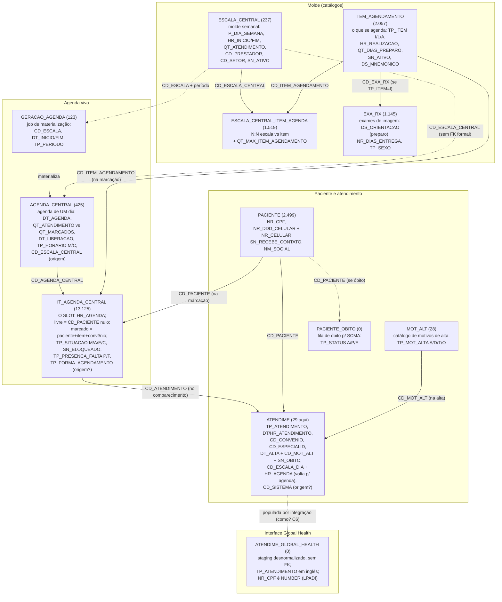

# Dicionário de colunas: agendamento e desfecho no banco MV (Oracle)

> Entregável da tarefa C3. Destilado dos resultados reais das queries de exploração (06-07/jul/2026, `resultados/`), cruzado com `dicionario-tabelas-mv.md` (planilha do TI) e com as hipóteses do ultracode em `perguntas-global-health.md`. Os CSVs completos de colunas estão em `resultados/1-2-*.csv` e `1-3-*.csv`; aqui ficam o mapa mental, as colunas que importam para a Ana e as perguntas em aberto.

## Achados-chave

1. **Owner canônico: `DBAMV`.** Todas as tabelas do fluxo vivem em `DBAMV` (prefixar `DBAMV.` nas queries). Única exceção: `MOTIVO_ALTA` vive em `DBAPS` e é um catálogo paralelo orientado a TISS; a tabela que o MV clássico usa é `DBAMV.MOT_ALT` (confirmada, 28 motivos ativos).
2. **Este banco parece ser homologação/teste, não a produção do hospital.** Estatísticas frescas (analisadas em 03-04/jul) mostram `ATENDIME` com 29 linhas e `PACIENTE` com 2.499, incompatível com 25-35 mil pacientes/mês. Há atividade recente (alta lançada em 06/jul), ou seja, é um ambiente vivo de testes. Consequências: (a) ótimo para o smoke test da integração GH, dá para chamar a API e ver a linha aparecer; (b) a Fase 3 (pós-atendimento, E1) exige acesso à base de PRODUÇÃO, que ainda não temos. Pergunta número 1 para o analista.
3. **`ATENDIME_GLOBAL_HEALTH` existe, tem 0 linhas e não tem FK nenhuma**: é uma tabela de interface (staging) da Global Health, desnormalizada (`DS_PRESTADOR`, `DS_ESPECIALIDADE`, `DS_ESTABELECIMENTO` como texto) e com enums em inglês (`TP_ATENDIMENTO`: `A`=ROUTINE, `H`=HOME CARE, `I`=INPATIENT, `U`=EMERGENCY). Nenhum agendamento via API jamais tocou este banco. Como ela é populada (trigger? job? a própria API?) é pergunta para a GH/analista.
4. **Armadilha de CPF**: `ATENDIME_GLOBAL_HEALTH.NR_CPF` é `NUMBER`; CPF com zero à esquerda perde dígito. Todo cruzamento por CPF deve normalizar com `LPAD(cpf, 11, '0')`.
5. **Desfecho tem 3 sinais redundantes, como a pesquisa previu**: `ATENDIME.SN_OBITO` (+ `CD_CID_OBITO`, `NR_DECLARACAO_OBITO`, `CD_SETOR_OBITO`), `ATENDIME.CD_MOT_ALT` → `MOT_ALT.TP_MOT_ALTA='O'`, e a fila `PACIENTE_OBITO` (processamento SCMA, `TP_STATUS` A/P/E). O filtro do disparo deve usar os três.
6. **A armadilha do luto que `TP_MOT_ALTA` não captura**: os motivos 63 (alta da mãe e ÓBITO do recém-nascido) e 64 (alta da mãe com óbito fetal) são tipo `A` (alta). Filtrar só por `TP_MOT_ALTA='O'` dispararia pesquisa de satisfação para puérperas enlutadas. A lista de exclusão precisa ser por código de motivo, não só por tipo.
7. **No-show já é medido pelo MV**: `IT_AGENDA_CENTRAL.TP_PRESENCA_FALTA` (`P` presença / `F` falta) + `DH_PRESENCA_FALTA`. Insumo pronto para KPIs e para o lembrete de consulta no futuro.
8. **Contato real do paciente**: DDD em coluna própria (`NR_DDD_CELULAR`=21 nas amostras) + `NR_CELULAR` com 9-10 dígitos; e-mail e fone fixo quase sempre vazios. Para WhatsApp: compor `55 + DDD + número`. `PACIENTE.SN_RECEBE_CONTATO` existe e veio `'N'` nas amostras: hoje não serve de evidência de opt-in (pauta E2).
9. **Marcadores de origem a confirmar**: `IT_AGENDA_CENTRAL.TP_FORMA_AGENDAMENTO` ("forma que foi feita o agendamento", nula nas amostras) e `ATENDIME.CD_SISTEMA` ("qual sistema criou o atendimento") são os candidatos a identificar o que veio da Ana/GH vs balcão. Domínios a perguntar (C6). `TP_VISUALIZACAO` (`B` balcão / `I` internet) qualifica o slot, não a origem da marcação.

## O fluxo do agendamento (com as colunas reais)

O modelo é: a **escala** é o molde semanal; a **geração** materializa o molde em **agendas** datadas; cada agenda nasce com seus **horários** (slots); marcar é preencher um slot com paciente + item; quando o paciente comparece, o slot ganha um **atendimento**; a alta do atendimento carrega o **desfecho**.

Leituras operacionais para a Ana (D2):

- **Disponibilidade** = slots de `IT_AGENDA_CENTRAL` com `CD_PACIENTE` nulo, `SN_BLOQUEADO='N'`, em `AGENDA_CENTRAL` ativa, liberada (`DT_LIBERACAO`) e com capacidade (`QT_MARCADOS < QT_ATENDIMENTO`). É isso que a API da GH deve estar consultando por baixo.
- **Efetivação** = preencher o slot (paciente, item, convênio/particular, contato) e, se multi-horário, agrupar via `CD_IT_AGENDA_PAI`.
- **Cancelamento** = `TP_SITUACAO='C'` (a confirmar se a API usa isso ou libera o slot).
- **Auditoria do que a Ana fez** = após o smoke test, verificar qual marcador a API preenche (`TP_FORMA_AGENDAMENTO`? `CD_SISTEMA`? `CD_USUARIO` de serviço?) e cravar a assinatura no dicionário.

## Dicionário por tabela (colunas que importam)

### `DBAMV.IT_AGENDA_CENTRAL` (o slot; 90 colunas, 13.125 linhas)

| Coluna | Tipo | Papel |
|---|---|---|
| `CD_IT_AGENDA_CENTRAL` | NUMBER | PK do slot |
| `CD_AGENDA_CENTRAL` | NUMBER | FK para a agenda do dia |
| `HR_AGENDA` | DATE | horário do slot |
| `CD_PACIENTE` | NUMBER | nulo = slot livre; preenchido = marcado |
| `NM_PACIENTE`, `DT_NASCIMENTO`, `TP_SEXO` | | dados soltos da marcação (redundantes com `PACIENTE`) |
| `CD_ITEM_AGENDAMENTO` | NUMBER | o que foi marcado |
| `CD_CONVENIO`, `CD_CON_PLA`, `CD_SUB_PLANO` | NUMBER | pagador (particular tem convênio próprio, ver achado D1 do ultracode) |
| `NR_DDD_CELULAR`, `NR_CELULAR`, `NR_FONE`, `DS_EMAIL` | | contato informado NA marcação |
| `TP_SITUACAO` | VARCHAR2 | `M` marcado / `A` aguardando / `E` atendido / `C` cancelado (nulo nas amostras livres) |
| `SN_ATENDIDO`, `SN_ENCAIXE`, `SN_ENCAIXE_EXTRA`, `SN_BLOQUEADO` | S/N | estado do slot |
| `CD_ATENDIMENTO` | NUMBER | FK para `ATENDIME` quando vira atendimento |
| `CD_IT_AGENDA_PAI` | NUMBER | agrupa os horários de uma mesma marcação |
| `DT_GRAVACAO` | DATE | quando a marcação foi feita |
| `TP_FORMA_AGENDAMENTO` | VARCHAR2 | forma/origem da marcação (domínio? C6) |
| `TP_VISUALIZACAO` | VARCHAR2 | `B` balcão / `I` internet |
| `TP_PRESENCA_FALTA`, `DH_PRESENCA_FALTA` | | `P`/`F`: comparecimento (no-show) |
| `VL_NEGOCIADO`, `VL_PERC_DESCONTO` | NUMBER | valores do particular |
| `CD_SENHA`, `NR_GUIA`, `NR_CARTEIRA`, `DT_VALIDADE_CARTEIRA` | | autorização de convênio |
| `DT_ENVIO_COMPROVANTE` | DATE | comprovante enviado (SMS legado) |

### `DBAMV.AGENDA_CENTRAL` (a agenda de um dia; 44 colunas, 425 linhas)

`CD_AGENDA_CENTRAL` PK · `TP_AGENDA` (amostra: `A`) · `DT_AGENDA` + `HR_INICIO`/`HR_FIM` · `CD_PRESTADOR`/`CD_SETOR`/`CD_UNIDADE_ATENDIMENTO` · capacidade: `QT_ATENDIMENTO`, `QT_ENCAIXES`, `QT_MARCADOS`, `QT_ENCAIXES_MARCADOS` · `DT_LIBERACAO` (quando a agenda fica visível) · `TP_HORARIO` (`M` hora marcada / `C` ordem de chegada) · `SN_ATIVO` · `CD_ESCALA_CENTRAL` (escala geradora; referência sem FK formal).

### `DBAMV.ESCALA_CENTRAL` (o molde; 32 colunas, 237 linhas)

`CD_ESCALA_CENTRAL` PK · `TP_ESCALA` · `TP_DIA_SEMANA` (1 a 7) · `HR_INICIO`/`HR_FIM` · `QT_ATENDIMENTO`/`QT_ENCAIXE` · `CD_PRESTADOR`/`CD_SETOR`/`CD_RECURSO_CENTRAL`/`CD_UNIDADE_ATENDIMENTO` · `QT_DIAS_LIBERACAO` (antecedência de liberação) · `SN_ATIVO` · restrições: `NR_IDADE_MINIMA`/`MAXIMA`, `QT_PESO_MAXIMO`. Itens agendáveis da escala via `ESCALA_CENTRAL_ITEM_AGENDA` (N:N com `QT_MAX_ITEM_AGENDAMENTO`).

### `DBAMV.ITEM_AGENDAMENTO` (o catálogo; 21 colunas, 2.057 linhas)

`CD_ITEM_AGENDAMENTO` PK · `DS_ITEM_AGENDAMENTO` · `TP_ITEM` (`I` imagem → `CD_EXA_RX`; `L` laboratório → `CD_EXA_LAB`; `A` ambulatório → `CD_PRO_FAT`) · `HR_REALIZACAO` (duração) · `QT_DIAS_PREPARO` + `DT_TEMPO_PREPARO` · `QT_TEMPO_INTERVALO`/`TP_INTERVALO` (carência entre repetições) · `SN_OBRIGA_PACIENTE_AGENDAMENTO` · `SN_OBRIGA_INDICACAO_CLINICA` · `SN_ATIVO` · `DS_MNEMONICO` (nome curto do SCMA).

### `DBAMV.EXA_RX` (exames de imagem; 36 colunas, 1.145 linhas)

`CD_EXA_RX` PK · `DS_EXA_RX` · `TP_SEXO` (restrição) · `DS_ORIENTACAO` (texto de preparo: insumo direto para a Ana) · `VL_TEMPO_MEDIO` · `NR_DIAS_ENTREGA` (prazo do laudo) · `SN_REALIZA_SEGUNDA..DOMINGO` · `SN_ATIVO`.

### `DBAMV.PACIENTE` (157 colunas, 2.499 linhas aqui)

`CD_PACIENTE` PK · `NM_PACIENTE` (+ `NM_SOCIAL_PACIENTE`/`SN_UTILIZA_NOME_SOCIAL`) · `DT_NASCIMENTO` · `NR_CPF` (VARCHAR2, 11) · `NR_CNS` · contato: `NR_DDD_CELULAR` + `NR_CELULAR` (9-10 dígitos), `NR_DDD_FONE` + `NR_FONE`, `EMAIL` · `SN_RECEBE_CONTATO` (aceite de comunicados; amostras = `N`) · `SN_NOTIFICACAO_SMS` · `TP_SITUACAO`/`SN_ATIVO` · `CD_PACIENTE_EXTERNO`/`CD_PACIENTE_INTEGRA` (chaves de integração) · `DS_HASH` (busca fonética).

### `DBAMV.ATENDIME` (o atendimento; 182 colunas, 29 linhas aqui)

| Coluna | Papel |
|---|---|
| `CD_ATENDIMENTO` | PK |
| `CD_PACIENTE`, `CD_CONVENIO`, `CD_CON_PLA` | quem e por qual pagador |
| `TP_ATENDIMENTO` | tipo (amostras: `U`, `E`, `A`; domínio completo a confirmar em C6: ambulatório/urgência/internação/externo) |
| `DT_ATENDIMENTO` + `HR_ATENDIMENTO`, `DT_CHEGADA_PACIENTE` | quando |
| `CD_PRESTADOR`, `CD_ESPECIALID`, `CD_SERVICO`, `CD_SETOR_LOCAL_FSCC` | quem atendeu e onde |
| `DT_ALTA` + `HR_ALTA`, `DT_ALTA_MEDICA` | alta administrativa vs médica |
| `CD_MOT_ALT` | motivo da alta → `MOT_ALT` (nas amostras veio nulo mesmo com `DT_ALTA`: confirmar obrigatoriedade em C6) |
| `SN_OBITO`, `CD_CID_OBITO`, `NR_DECLARACAO_OBITO`, `CD_SETOR_OBITO`, `TP_ENCAMINHAMENTO_OBITO` | sinais diretos de óbito |
| `SN_RETORNO`, `DT_RETORNO` | retorno |
| `CD_ESCALA_DIA`, `HR_AGENDA` | ponte de volta: qual escala/horário gerou o atendimento |
| `CD_SISTEMA` | qual sistema criou o atendimento (domínio? C6) |
| `SN_INTERNADO`, `CD_LEITO`, `CD_TIPO_INTERNACAO` | internação |
| `CD_MULTI_EMPRESA` | unidade |

### Desfecho: `DBAMV.MOT_ALT` (28 motivos, catálogo real) e vizinhos

`TP_MOT_ALTA`: `A` alta · `D` permanência · `T` transferência · `O` óbito. Classificação PROPOSTA para o filtro do disparo (validar com o analista e a direção em C6/E1):

| Bucket | Códigos | Regra |
|---|---|---|
| **Disparo ok** | 11 (curado), 12 (melhorado), 15 (retorno programado), 61 (alta mãe e RN) | eletivo + estes motivos = população da pesquisa |
| **Avaliar com o hospital** | 14 (a pedido), 18 (outros), 19 (psiquiatria), 51 (encerramento administrativo), 62 (alta mãe, RN permanece) | casos sensíveis ou ambíguos; fora do POC inicial |
| **Nunca disparar** | 16 (evasão), 21-28 (permanência, tipo `D`), 31-32 (transferência, tipo `T`), 41-43 e 65-67 (óbito, tipo `O`), **63 e 64 (tipo `A`, mas óbito de RN/fetal: LUTO)** | lista de exclusão por CÓDIGO, não só por tipo |

Regra combinada do filtro (esboço, refina na E1): `TP_ATENDIMENTO` eletivo E `DT_ALTA` recente E `CD_MOT_ALT` no bucket ok E `SN_OBITO <> 'S'` E paciente fora de `PACIENTE_OBITO` E celular presente. A query candidata completa está em `perguntas-global-health.md` (seção de hipóteses); ela se confirma neste schema.

`DBAPS.MOTIVO_ALTA` (43 linhas): catálogo paralelo com `CD_TISS`/`CD_PTU`; qual dos dois o hospital usa de fato em `ATENDIME.CD_MOT_ALT` (não há FK declarada) é pergunta C6.

`DBAMV.PACIENTE_OBITO` (0 linhas aqui): fila de processamento de óbito para o SCMA (`TP_STATUS`: `A` a processar / `P` processado / `E` erro). Na produção, é o terceiro sinal do filtro.

### `DBAMV.ATENDIME_GLOBAL_HEALTH` (interface GH; 10 colunas, 0 linhas)

`CD_ATENDIMENTO` · `TP_ATENDIMENTO` (`A`=ROUTINE, `H`=HOME CARE, `I`=INPATIENT, `U`=EMERGENCY) · `NR_CPF` (**NUMBER**: normalizar com `LPAD(11)`) · `DH_ATENDIMENTO`, `DT_ALTA` · `CD_CID`/`DS_CID` · `DS_PRESTADOR`, `DS_ESPECIALIDADE`, `DS_ESTABELECIMENTO` (texto desnormalizado). Sem FKs: staging de integração. Como e quando é populada (job, trigger, escrita direta da GH) define se ela serve de trilha de auditoria do agendamento via Ana.

## Perguntas para o analista de TI (C6) e para a GH

1. Este banco (owner `DBAMV`, ~2,5 mil pacientes) é a homologação? Onde vive a produção e qual o caminho para leitura read-only dela (pré-condição da Fase 3 / E1)?
2. `ATENDIME.TP_ATENDIMENTO`: domínio completo e qual valor identifica o eletivo/ambulatorial (para o recorte do disparo)?
3. `ATENDIME.CD_MOT_ALT` aponta para `DBAMV.MOT_ALT` ou `DBAPS.MOTIVO_ALTA`? É obrigatório na alta? (amostra tem `DT_ALTA` sem motivo)
4. `ATENDIME_GLOBAL_HEALTH`: quem popula, em qual momento, e em qual ambiente? Um agendamento feito pela API de homolog aparece aqui?
5. Domínios de `IT_AGENDA_CENTRAL.TP_FORMA_AGENDAMENTO` e `ATENDIME.CD_SISTEMA`: qual assinatura identifica marcação vinda da API/GH (auditoria da Ana)?
6. Confirmação da leitura de disponibilidade (slot livre = `CD_PACIENTE` nulo + `SN_BLOQUEADO='N'` + agenda liberada): é assim que a API da GH consulta?

## Validação pendente

O "pronto" pleno do C3 (ver o agendamento da API aparecer no banco, cruzando com `ATENDIME_GLOBAL_HEALTH`) depende do smoke test da GH homolog (D1): fazer uma marcação de teste pela API e reconsultar `IT_AGENDA_CENTRAL` (por `DT_GRAVACAO` recente) e `ATENDIME_GLOBAL_HEALTH`. Se este Oracle for mesmo a homolog da GH, o loop fecha ponta a ponta.
