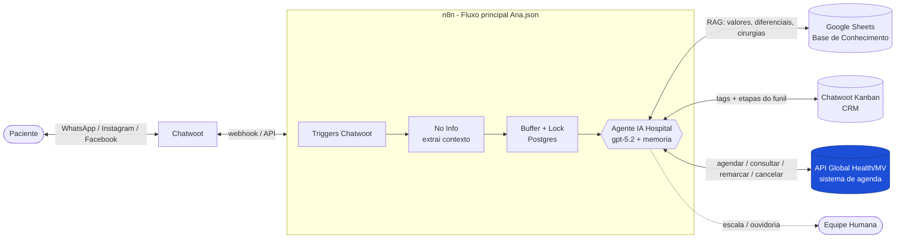
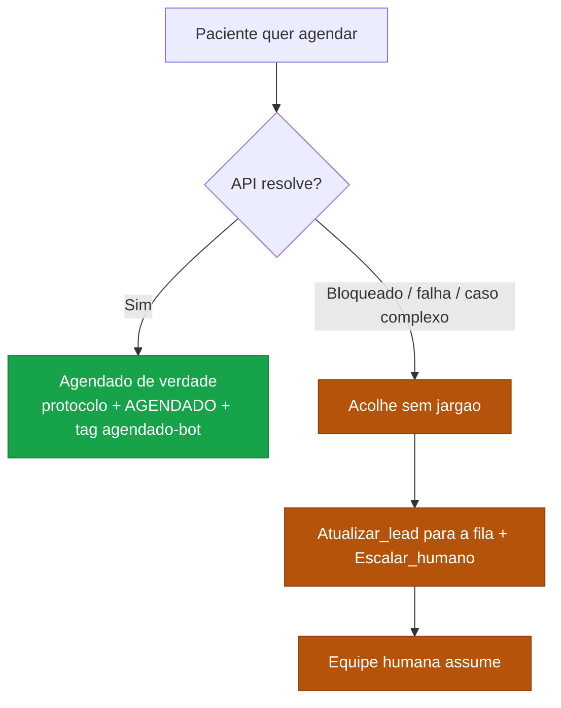

# Ana — Visão Geral do Ecossistema

> Assistente virtual do **Hospital São Matheus** (Bangu, Rio de Janeiro). Atende pacientes por WhatsApp, Instagram e Facebook, 24/7, com foco em agendamento de consultas e exames, informações, ouvidoria e triagem.

Esta documentação descreve **todas as funções da Ana** — as que já existem hoje e as **novas funções de agendamento real** que serão adicionadas com a integração à API da Global Health/MV.

| Documento | O que contém |
|---|---|
| **00-visao-geral.md** *(este)* | O ecossistema, o runtime e o princípio híbrido |
| [01-catalogo-funcoes.md](01-catalogo-funcoes.md) | Ficha de cada função (atuais + novas) |
| [02-arquitetura-agendamento.md](02-arquitetura-agendamento.md) | As 7 tools de agendamento: subfluxos, estado, fallback |
| [03-fluxos-conversacionais.md](03-fluxos-conversacionais.md) | Roteiros + diagramas de cada jornada |
| [04-sop-ana-reescrito.md](04-sop-ana-reescrito.md) | O system prompt novo, pronto para colar |
| [05-guia-implementacao-n8n.md](05-guia-implementacao-n8n.md) | Como construir e testar no n8n |
| [painel/index.html](painel/index.html) | Painel visual interativo |

---

## 1. O que é a Ana

A Ana é um **agente de IA** orquestrado no **n8n**. Ela não é um chatbot de árvore de decisão: é um *Tools Agent* que raciocina sobre cada mensagem e decide quais ferramentas chamar, seguindo um **SOP (Procedimento Operacional Padrão)** detalhado no seu system prompt.

- **Canais:** WhatsApp, Instagram, Facebook — todos through o **Chatwoot**.
- **Disponibilidade:** a Ana funciona 24/7. A equipe humana atende de segunda a sexta, 7h–18h.
- **Papel:** agendar consultas/exames, informar serviços/valores/convênios, registrar ouvidoria, orientar prontuário e resultados, e escalar para humano quando necessário.

---

## 2. Diagrama de contexto

> A caixa **API Global Health/MV** em destaque é a peça nova. Tudo o mais já existe e permanece.

---

## 3. Componentes do ecossistema

| Componente | Papel | Estado |
|---|---|---|
| **Chatwoot** | Caixa de entrada omnichannel + CRM (Kanban + tags). Recebe e envia mensagens; guarda contato, conversa, etiquetas e `custom_attributes`. | Mantido |
| **n8n — `Ana.json`** | Orquestração: triggers, processamento de mídia (áudio/imagem), fila/lock anti-concorrência, o nó do agente e o envio da resposta. | Mantido + novas tools |
| **Agente IA Hospital** | O nó `@n8n/n8n-nodes-langchain.agent` rodando **`gpt-5.2`**, com **memória Postgres** (por conversa) e o SOP no system prompt. | SOP reescrito |
| **Google Sheets** | Base de conhecimento (RAG): valores particulares, diferenciais comerciais, convênios e estimativas de cirurgia. | Mantido — vira o **discurso comercial** |
| **Chatwoot Kanban** | Funil do paciente: etapas (colunas) e tags (etiquetas). Faz as vezes de CRM. | Mantido + novas tags/etapas |
| **API Global Health/MV** | Sistema de agenda do hospital. Permite agendar/consultar/remarcar/cancelar de verdade. | **NOVO** |
| **Postgres** | Memória da conversa + fila de mensagens + lock de atendimento. | Mantido |

---

## 4. O princípio híbrido (a regra que rege a integração)

A Ana **tenta resolver o agendamento de ponta a ponta pela API**. Se a API bloquear, falhar ou o caso fugir do que ela consegue tratar, ela **acolhe, registra e cai no fluxo humano que já existe** (mover o card para a fila certa + escalar para um atendente) — sem nunca expor termos técnicos ao paciente.

**Por que híbrido?** Porque preserva 100% da maquinaria humana já testada (filas, escalada, ouvidoria) e adiciona a automação por cima, como caminho preferencial. O risco de migração é mínimo: se a API não responder, o paciente continua sendo atendido como sempre foi.

**Divisão de papéis Sheets × API:**
- **Google Sheets** → discurso comercial: diferenciais ("aqui você conta com…"), ancoragem de valor e estimativas de **cirurgia** (a API não cobre cirurgia).
- **API** → disponibilidade real, valor real do horário e a **execução** do agendamento.
- Em conflito de preço, a **API prevalece** para o agendamento; a Sheet serve à conversa.

---

## 5. Glossário

| Termo | Significado |
|---|---|
| **SOP** | Procedimento Operacional Padrão — o conjunto de regras e roteiros no system prompt da Ana. |
| **Tool** | Ferramenta que o agente pode chamar (ex.: `Buscar_disponibilidade`). No n8n, cada uma aponta para um **subfluxo**. |
| **Subfluxo** | Workflow n8n separado, acionado pelo agente via nó `executeWorkflowTrigger` ("Gatilho"). |
| **Etapa (Kanban)** | Coluna do funil onde o card do paciente está (ex.: `EM ATENDIMENTO — ANA`, `AGENDADO`). |
| **Tag** | Etiqueta aplicada ao card/conversa (ex.: `agendado-bot`, `ouvidoria`). |
| **Lead / card** | O paciente representado como cartão no Kanban do Chatwoot (`tarefa.id`). |
| **`Info`** | Nó do `Ana.json` que extrai o contexto de cada mensagem (ids, telefone, nome, tarefa, atributos). |
| **`custom_attributes`** | Campos personalizados da conversa no Chatwoot — usados para guardar o **estado da jornada de agendamento**. |
| **`idItemAgendamento`** | ID do que se quer agendar (uma consulta ou um exame) na API. |
| **`idHorario` / `idAgenda`** | ID de um horário específico / da agenda do prestador, na API. |
| **`protocolo`** | Número do agendamento confirmado, retornado pela API. |
| **`impedeRealizacao`** | Flag (S/N) de uma resposta de triagem de exame que **bloqueia** o agendamento (ex.: gravidez). |
| **Prefixo-sinal** | Marcador no início da resposta de um subfluxo (ex.: `BLOQUEADO:`, `NAO_AGENDADO:`) que diz à Ana se deve seguir ou cair no humano. |
| **Global Health / MV** | Empresa/sistema que fornece a API de agendamento do hospital. |
