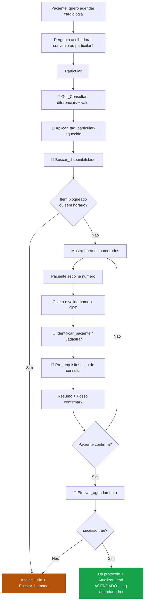
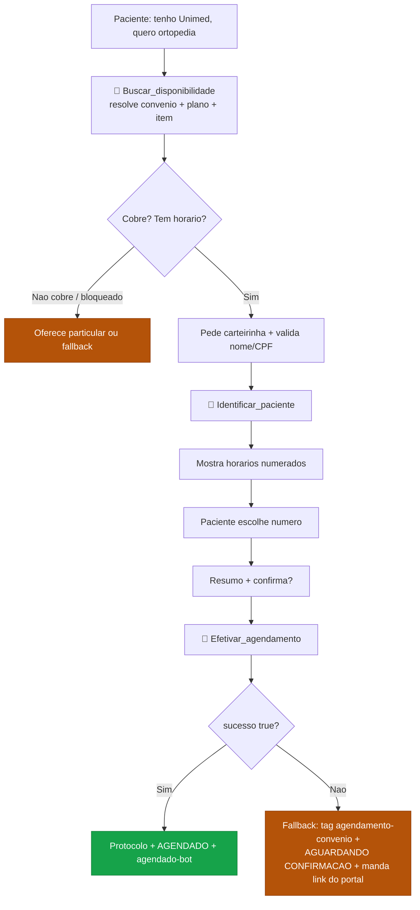
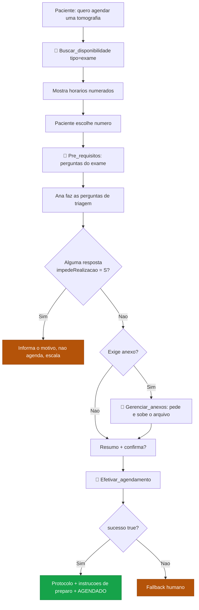
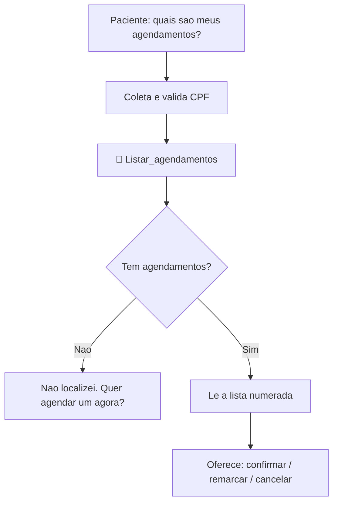
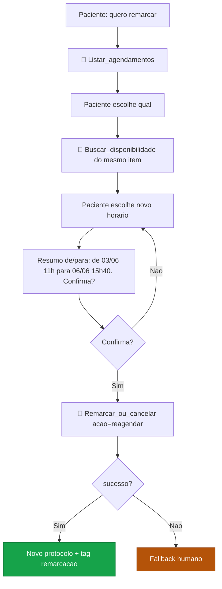
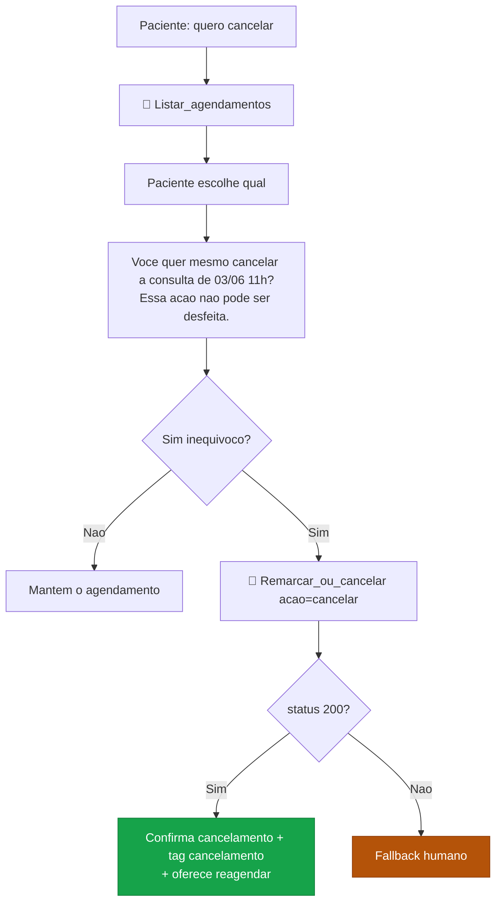
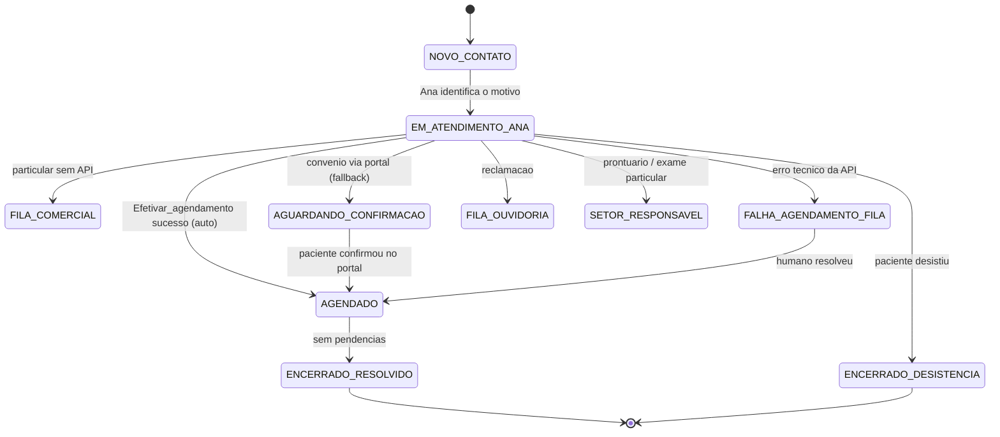

# Fluxos Conversacionais

Roteiros e diagramas de cada jornada. Cada fluxo mostra o **caminho feliz pela API** e o **ponto de decisão híbrido** (sucesso → `AGENDADO`; bloqueio/falha → fila humana). As falas seguem o estilo da Ana: PT-BR, acolhedor, frases curtas, uma pergunta por mensagem, sem markdown.

> Convenção dos diagramas: retângulo = ação/fala da Ana · losango = decisão · 🔧 = chamada de tool · verde = sucesso · âmbar = fallback humano.

---

## 1. Agendar consulta — Particular

A Sheet dá o discurso comercial (diferenciais + valor); a API dá o horário e executa.



**Roteiro (exemplo):**
```
Paciente: quero marcar uma consulta de cardiologia
Ana: Claro! Você vai usar convênio ou prefere agendar como particular? Pergunto para já verificar tudo certinho.
Paciente: particular
Ana: Aqui no São Matheus você conta com cardiologistas e estrutura de diagnóstico completa.
     A consulta de cardiologia é R$ 120. Posso verificar os horários disponíveis?
Paciente: pode
Ana: Encontrei estes horários:
     1 - 03/06 às 11h, Dra. Fernanda
     2 - 04/06 às 13h45, Dra. Caroline
     Qual número fica melhor?
Paciente: 1
Ana: Para confirmar o agendamento, pode me passar seu nome completo e CPF?
Paciente: Paciente Teste, 000.000.000-00
Ana: Confirmando: consulta de cardiologia, 03/06 às 11h, com a Dra. Fernanda, no valor de R$ 120. Posso confirmar?
Paciente: sim
Ana: Prontinho, sua consulta está agendada!
     Protocolo 725782, dia 03/06 às 11h, na Rua Silva Cardoso, 689. Posso ajudar em mais algo?
```

---

## 2. Agendar consulta — Convênio

O portal (`centraldemarcacao.com.br`) deixa de ser o caminho principal e vira **fallback**.



> **O comportamento de hoje (link do portal + "me avisa se conseguiu?") é exatamente o ramo de fallback.** Nada do que já funciona é descartado.

---

## 3. Agendar exame (com triagem e anexos)

Diferença para consulta: `Pre_requisitos_agendamento` traz **perguntas de triagem** (com bloqueio por `impedeRealizacao`) e pode exigir **anexos**.



**Trecho de triagem:**
```
Ana: Antes de agendar preciso confirmar uma coisa: você está grávida ou suspeita de gravidez?
Paciente: não
Ana: Para este exame é necessário o pedido médico. Pode enviar a foto ou o PDF aqui no chat?
Paciente: [envia imagem]
Ana: Recebi, obrigada! Confirmando: tomografia de crânio, 05/06 às 12h, na unidade Centro. Posso confirmar?
Paciente: sim
Ana: Agendado! Protocolo 725782, 05/06 às 12h. Preparo: jejum de 4 horas. Posso ajudar em mais algo?
```

---

## 4. Consultar agendamentos

Substitui a antiga Seção 4 ("acesse o portal").



```
Ana: Você tem 1 agendamento ativo:
     Consulta de cardiologia, 03/06 às 11h, unidade Centro. Protocolo 725782.
     Quer confirmar, remarcar ou cancelar?
```

---

## 5. Remarcar



---

## 6. Cancelar (confirmação reforçada)



```
Paciente: quero cancelar minha consulta
Ana: Você tem a consulta de cardiologia de 03/06 às 11h. Quer mesmo cancelar? Essa ação não pode ser desfeita.
Paciente: sim, pode cancelar
Ana: Pronto, sua consulta foi cancelada. Quer que eu procure um novo horário?
```

---

## 7. Máquina de estados do Kanban (visão de funil)

Como o card caminha pelas etapas, com os pontos automáticos da Ana:



> `AGENDADO` (auto) e `FALHA AGENDAMENTO — FILA` são as novidades. As demais etapas e transições são as de hoje.

---

## 8. Resumo dos pontos de confirmação e fallback

| Jornada | Confirmação obrigatória antes de | Sinais que levam ao humano |
|---|---|---|
| Agendar consulta/exame | `Efetivar_agendamento` | `BLOQUEADO`, `SEM_HORARIOS`, `NAO_AGENDADO`, `BLOQUEIO_EXAME`, `ERRO_API`, `ERRO_ANEXO` |
| Remarcar | `Remarcar_ou_cancelar` (reagendar) | `NAO_AGENDADO`, `ERRO_API` |
| Cancelar | `Remarcar_ou_cancelar` (cancelar) — **"sim" inequívoco** | `ERRO_API` |
| Consultar | — (leitura) | `ERRO_API` |
