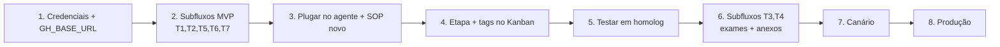

# Guia de Implementação no n8n

Passo-a-passo para construir as 7 tools de agendamento, plugá-las na Ana e testar. Referência técnica: [02-arquitetura-agendamento.md](02-arquitetura-agendamento.md). SOP a aplicar: [04-sop-ana-reescrito.md](04-sop-ana-reescrito.md).

---

## 0. Pré-requisitos

- [ ] **Token da API Global Health/MV** (solicitar à Global Health). Idealmente um para **homologação** e um para **produção**.
- [ ] Confirmar com a Global Health se a URL de anexo do Chatwoot (`data_url`) é **acessível externamente** pela API (necessário para `Gerenciar_anexos`). Se não for, planejar um storage público intermediário.
- [ ] Acesso de edição aos workflows n8n e ao `Ana.json`.
- [ ] Conferir se a credencial Chatwoot atual consegue **escrever** `custom_attributes` de conversa (testar um `POST .../conversations/{id}/custom_attributes`).

---

## 1. Configurar credenciais e ambiente

### 1.1 Credencial do Token (Header Auth)
1. n8n → **Credentials** → **New** → **Header Auth**.
2. Nome: `GH Token (Homolog)`. Header **Name**: `Token`. **Value**: `<token de homologação>`.
3. Repetir criando `GH Token (Prod)` quando for para produção.

> Use **sempre** essa credencial nos nós HTTP (campo *Authentication → Predefined Credential Type → Header Auth*). Nunca cole o token em texto puro no nó.

### 1.2 Base URL por ambiente
- Criar a variável de ambiente do n8n `GH_BASE_URL`:
  - Homolog: `https://dem.agenda.globalhealth.mv/rest/whatsapp`
  - Prod: `https://whatsapp.agenda.globalhealth.mv/rest/whatsapp`
- Nos nós HTTP, montar a URL como `={{ $env.GH_BASE_URL }}/consultas?pesquisa={{ $json.procedimento }}`.

> Alternativa, se preferir não usar env var: um nó `Set` "Config" no topo de cada subfluxo definindo `baseUrl`. Menos limpo, mas visível.

---

## 2. Construir os subfluxos (um workflow por tool)

Para cada uma das 7 tools, criar um **workflow novo** com este esqueleto:

```
[Gatilho]  executeWorkflowTrigger   → declarar os inputs (nomes da §4 do doc 02)
   → [HTTP Request]  (Auth: GH Token; onError: Continue (using error output))
   → [Code/IF/Switch]  (achatar resposta, tratar erro, gerar prefixo-sinal)
   → [Responder]  Set  → campo único: resposta (string)
```

Ordem sugerida de construção (do mais simples ao mais complexo): **T6 Listar_agendamentos → T1 Identificar_paciente → T2 Buscar_disponibilidade → T5 Efetivar_agendamento → T7 Remarcar_ou_cancelar → T3 Pre_requisitos → T4 Gerenciar_anexos.**

### Notas por subfluxo
- **T1 `Identificar_paciente`:** `GET /pessoas?cpf=` com `onError: continue`; `IF` para "encontrou?"; ramo de cadastro com `POST /pessoas`.
- **T2 `Buscar_disponibilidade`:** `Switch(tipo)` → `/consultas` ou `/exames`; `Code` "Resolver item" (trata `bloqueado`); ramo convênio (`/convenios` + `/planos`); `GET /agendas/v2`; `Code` "Achatar agendas" (copiar o snippet da §5 do doc 02); nó de **gravar estado**; `Set resposta`.
- **T3 `Pre_requisitos_agendamento`:** lê estado; `Code` resolve `numero_escolhido`→`idAgenda`; `IF(tipo)` → `/consultas/tipos` ou `/exames/perguntas`; grava perguntas no estado.
- **T4 `Gerenciar_anexos`:** `Switch(modo)`; `POST /anexos/agendamento` (verificar) ou mapeia MIME + `POST /anexos/upload` (enviar); acumula em `estado.anexos`.
- **T5 `Efetivar_agendamento`:** `IF(confirmado != true)` early-return; `Code` "Validar exame" (`impedeRealizacao`); `Code` "Resolver horário"; `IF` tipo de consulta pendente; `Code` "Montar body"; `POST /horarios/agendar` `onError: continue`; `IF(sucesso)` → limpa estado / prefixo.
- **T6 `Listar_agendamentos`:** `GET /agendamentos?cpf=`; `Code` achatar+numerar; grava `mapaAgendamentos`.
- **T7 `Remarcar_ou_cancelar`:** `IF(confirmado != true)` early-return; `Switch(acao)` → `reagendar` (`POST /horarios/reagendar`) ou `cancelar` (`DELETE /agendamentos/{id}`).

### Gravar e ler o estado (`agendamento_estado`)
- **Ler** (input fixo da tool): `={{ $('Info').item.json.atributos_conversa.agendamento_estado }}` → `JSON.parse` dentro do subfluxo.
- **Gravar** (nó HTTP no subfluxo):
  - Método `POST`, URL `=https://chatwoot.mala-ia.cloud/api/v1/accounts/{{ $json.id_conta }}/conversations/{{ $json.id_conversa }}/custom_attributes`
  - Header `api_access_token` (credencial Chatwoot existente)
  - Body (JSON): `{ "custom_attributes": { "agendamento_estado": "={{ JSON.stringify($json.estadoNovo) }}" } }`
- **Limpar:** mesmo POST com `agendamento_estado` = `""` ao concluir com sucesso. **Acrescentar `agendamento_estado` à lista de atributos limpos no nó de `/reset` da Ana.**

---

## 3. Plugar as tools no Agente IA Hospital (`Ana.json`)

1. Para cada subfluxo, adicionar um nó `@n8n/n8n-nodes-langchain.toolWorkflow`.
2. Apontar `workflowId` para o subfluxo; preencher `workflowInputs` com a mistura fixo/IA da §4 do doc 02 (espelhar o nó `Atualizar_lead` existente).
3. Conectar a saída do nó à entrada **`ai_tool`** do `Agente IA Hospital`.
4. Preencher o campo **description** de cada tool com o texto da §4 do doc 02 (é o que o agente lê para decidir quando usar).
5. Substituir o **systemMessage** do agente pelo conteúdo de [04-sop-ana-reescrito.md](04-sop-ana-reescrito.md).
6. Criar no Chatwoot Kanban a etapa **`FALHA AGENDAMENTO — FILA`** e as tags **`agendado-bot`**, **`remarcacao`**, **`cancelamento`**.

> Comece pelo **MVP** (T1, T2, T5, T6, T7) para cobrir agendar/consultar/remarcar/cancelar de consulta. Adicione T3 e T4 depois, para exames e itens com anexo.

---

## 4. Checklist de testes (por jornada)

Testar cada subfluxo isolado (botão *Execute Workflow* com pinData no Gatilho) e depois ponta a ponta em homologação.

### Caso feliz
- [ ] **Agendar consulta particular:** Get_Consultas → Buscar_disponibilidade → escolher nº → nome/CPF → Identificar → tipo → confirmar → Efetivar → protocolo + `AGENDADO` + `agendado-bot`.
- [ ] **Agendar consulta convênio:** resolve convênio/plano + carteirinha → horários → confirmar → Efetivar.
- [ ] **Agendar exame:** perguntas de triagem respondidas → (anexo se exigido) → Efetivar → instruções de preparo.
- [ ] **Consultar:** Listar_agendamentos retorna lista numerada.
- [ ] **Remarcar:** Listar → novo horário → confirmar "de/para" → Reagendar → novo protocolo + `remarcacao`.
- [ ] **Cancelar:** Listar → confirmação reforçada → Cancelar → `cancelamento`.

### Fallbacks (cada um deve cair no humano corretamente)
- [ ] Item `bloqueado:true` → `BLOQUEADO:` → acolhe + fila + escala.
- [ ] Exame com `impedeRealizacao=S` → `BLOQUEIO_EXAME:` → não agenda, escala.
- [ ] `agendas` vazio → `SEM_HORARIOS` → oferece próxima data / humano.
- [ ] `sucesso:false` (horário tomado) → `NAO_AGENDADO:` → rebusca 1× / escala.
- [ ] Erro/timeout da API → `ERRO_API` → `FALHA AGENDAMENTO — FILA` + escala.
- [ ] Upload de anexo falha → `ERRO_ANEXO` → escala.
- [ ] Número fora da lista → `NUMERO_INVALIDO` → pede número válido (não chama API).

### Guardrails
- [ ] Tentar efetivar **sem** `confirmado=true` → nó-gate barra (API não é chamada).
- [ ] CPF inválido (≠ 11 dígitos) → Ana pede só o CPF, não avança.
- [ ] Estado: após Efetivar com sucesso, `agendamento_estado` fica vazio.
- [ ] `/reset` limpa `agendamento_estado`.
- [ ] LLM não emite `idHorario`/`protocolo` que não vieram de ferramenta.

> Dá para disparar testes pelo MCP do n8n (`execute_workflow`) com payloads de exemplo, ou pelo próprio editor do n8n.

---

## 5. Rollout

1. **Homologação:** `GH_BASE_URL` apontando para `dem.agenda...` + `GH Token (Homolog)`. Rodar todo o checklist.
2. **Canário:** habilitar as tools para um subconjunto (ex.: uma inbox/horário específico) e acompanhar os cards `agendado-bot` vs `FALHA AGENDAMENTO — FILA`.
3. **Produção:** trocar `GH_BASE_URL` para `whatsapp.agenda...` e a credencial para `GH Token (Prod)`. Manter o portal/fila como fallback ativo.
4. **Observabilidade:** acompanhar no Kanban a proporção de `AGENDADO` (auto) vs fallback; revisar conversas que caíram em `FALHA AGENDAMENTO — FILA` para ajustar prompt/subfluxos.

---

## 6. Ordem de trabalho sugerida



---

## 7. Próximo passo opcional (geração dos JSONs)

Se quiser, os 7 subfluxos e o `Ana.json` atualizado podem ser **gerados como arquivos `.json` importáveis** no n8n (em vez de montados à mão), seguindo exatamente esta especificação. Basta pedir — é a fase seguinte natural a esta documentação.
