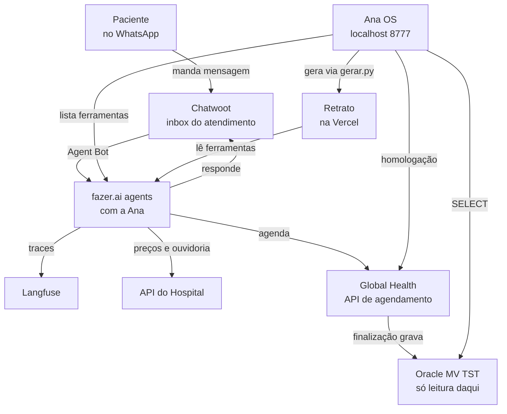

# FLUXOGRAMAS.md
<!-- gerado por /snapshot; não editar à mão -->

Diagramas curados no `snapshot.py` (não saem do código). Subset `flowchart TD` aceito
pelo `tools/workflow-dashboard/diagramas.py`.

## Contexto: quem conversa com quem

O paciente fala só com o WhatsApp do hospital; o Chatwoot entrega a conversa à Ana
na fazer.ai agents, que registra cada execução no Langfuse. A Ana lê preços e grava a
ouvidoria na API do Hospital e marca pela Global Health, que só grava no Oracle do MV
na finalização. O Ana OS é o cockpit local: chama a homologação da Global Health,
consulta a base TST em leitura e monta o Retrato publicado na Vercel.
