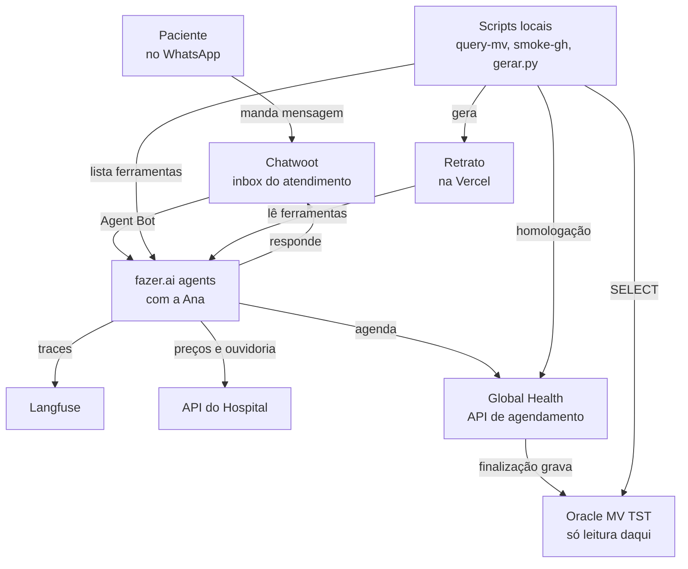

# FLUXOGRAMAS.md
<!-- gerado por /snapshot; não editar à mão -->

Diagramas curados no `snapshot.py` (não saem do código). Subset `flowchart TD` aceito
pelo `coletor/diagramas.py` do PedroOS.

## Contexto: quem conversa com quem

O paciente fala só com o WhatsApp do hospital; o Chatwoot entrega a conversa à Ana
na fazer.ai agents, que registra cada execução no Langfuse. A Ana lê preços e grava a
ouvidoria na API do Hospital e marca pela Global Health, que só grava no Oracle do MV
na finalização. Os scripts locais chamam a homologação da Global Health,
consultam a base TST em leitura e montam o Retrato publicado na Vercel.
