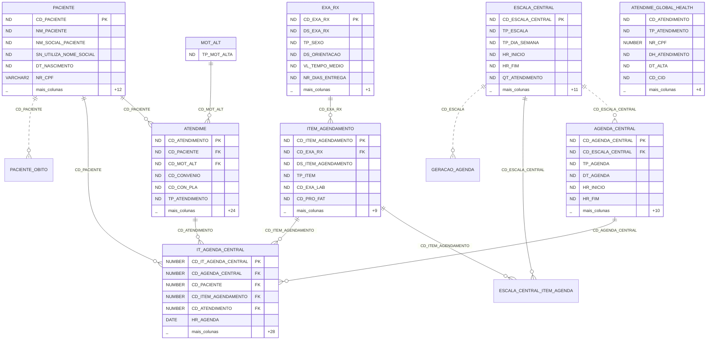

# SCHEMA.md
<!-- gerado por /snapshot; não editar à mão -->

Banco externo do hospital: o Oracle do MV (owner `DBAMV`), na base TST (teste), só leitura.
O programa não cria nem altera tabela nenhuma; o que está aqui são as tabelas já estudadas,
lidas de `ana/api-mv/dicionario-colunas.md`. Só as colunas que o dicionário cita, não a tabela inteira.
Ligação contínua: chave declarada no fluxo do dicionário; tracejada: referência sem FK formal.
`ND`: tipo que o dicionário não registra. A ficha completa de cada tabela está em ENTIDADES.

## Diagrama ER (Mermaid)

