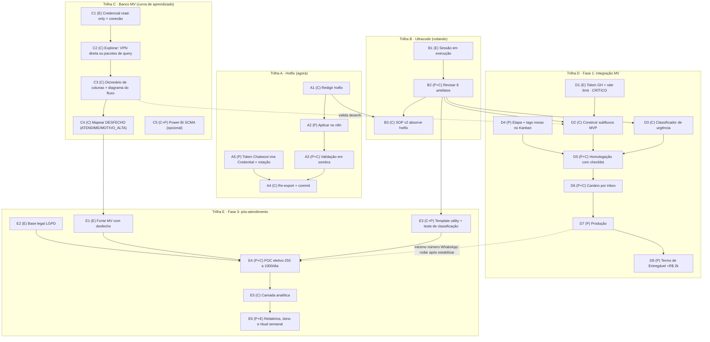

# TODO — Programa Ana: guia de execução até o final

> Fonte de verdade operacional do projeto. O `roadmap/index.html` conta a história para gestão; este arquivo guia o trabalho. Cada tarefa tem ID estável, dono e dependências. A seção "Fronteira de agora" diz o que está desbloqueado neste momento; ela é reescrita a cada avanço.

**Status:** `[ ]` a fazer · `[~]` em curso · `[x]` feito · `[!]` bloqueada
**Donos:** **(P)** Pedro · **(C)** Claude (sessões) · **(E)** Externo (hospital, Global Health, jurídico)

---

## Fronteira de agora (03/jul/2026 · tudo abaixo pode andar em paralelo)

| # | Tarefa | Dono | Por que agora |
|---|---|---|---|
| A1 | Redigir o hotfix do prompt | C | Única tarefa técnica 100% desbloqueada; risco vivo em produção |
| C1 | Pedir credencial Oracle read-only ao analista | P | Destrava toda a Trilha C; mensagem pronta no chat da sessão |
| D1 | Pedir token GH (homolog + prod) + rate limit | P→E | CAMINHO CRÍTICO: lead time externo domina a Fase 1 |
| E2 | Abrir a pergunta LGPD com o jurídico do hospital | P→E | Lead time externo; trava o POC do pós-atendimento |
| B1 | Sessão ultracode rodando | E | Só aguardar e revisar quando terminar |
| C5 | (Opcional) Varredura do Power BI/SCMA via Chrome | C+P | A qualquer momento, com o navegador aberto |

---

## Árvore de dependências

Leituras da árvore:
- **Caminho crítico até a receita (+R$ 2k):** D1 → D2 → D5 → D6 → D7 → D8. Tudo começa no token GH; por isso D1 se pede HOJE, mesmo com a construção ainda longe.
- **Trilhas A, B e C são independentes entre si**: hotfix, pesquisa e banco andam em paralelo total.
- **C alimenta E**: sem mapear o desfecho no banco (C4), a Fase 3 não tem filtro seguro (E1).
- **B2 é o pivô**: a revisão dos artefatos do ultracode destrava a construção (D2, D3) e o template (E3).

---

## Trilha A — Hotfix do prompt (agora)

| ID | St | Tarefa | Dono | Depende de |
|---|---|---|---|---|
| A1 | `[ ]` | Redigir `Ana_System_Prompt.md` v1.1: urgência como Regra Global 1, Regra 6 (assistente virtual), exclusão ouvidoria↔comercial, guardrails jurídicos, acentuação, tag `fora-horario`, etapa órfã, Seção 8.4 | C | nada |
| A2 | `[ ]` | Aplicar no nó `Agente IA Hospital` (colar manualmente ou via API key do n8n) | P | A1 |
| A3 | `[ ]` | Validação em sombra por período curto (tom da urgência e do comercial) | P+C | A2 |
| A4 | `[ ]` | Re-exportar workflows para `ana/workflows/` e commitar | C | A3, A5 |
| A5 | `[ ]` | Migrar token Chatwoot para Credential do n8n + rotacionar | P | nada |

## Trilha B — Pesquisa ultracode

| ID | St | Tarefa | Dono | Depende de |
|---|---|---|---|---|
| B1 | `[~]` | Sessão ultracode em execução (disparada em 03/jul) | E | nada |
| B2 | `[ ]` | Revisar os 8 artefatos, decidir o que entra, commitar | P+C | B1 |
| B3 | `[ ]` | Consolidar SOP v2 (hotfix + agendamento + achados da pesquisa) | C | A1, B2 |

## Trilha C — Banco MV (curva de aprendizado)

| ID | St | Tarefa | Dono | Depende de |
|---|---|---|---|---|
| C1 | `[ ]` | Credencial Oracle read-only + host/porta/service name + schema (MVBIKE? MVINTEGRA?) | P→E | nada |
| C2 | `[ ]` | Explorar estrutura: conexão direta (VPN + python-oracledb) ou Pacotes 1 e 2 de `ana/api-mv/queries-exploracao.md` | C | C1 |
| C3 | `[ ]` | Gerar `ana/api-mv/dicionario-colunas.md` + diagrama do fluxo de agendamento no banco | C | C2 |
| C4 | `[ ]` | Mapear onde vive o desfecho (`ATENDIME`, `MOTIVO_ALTA`, óbito) e como filtrar | C | C3 |
| C5 | `[ ]` | (Opcional) Varredura do Power BI módulo SCMA via Chrome: KPIs que a gestão já vê | C+P | navegador aberto |
| C6 | `[ ]` | Validar leitura do encadeamento com o analista de TI | P | C3 |

## Trilha D — Fase 1: integração MV

| ID | St | Tarefa | Dono | Depende de |
|---|---|---|---|---|
| D1 | `[ ]` | Token GH homolog + prod e limites de chamadas (pedir HOJE; caminho crítico) | P→E | nada |
| D2 | `[ ]` | Construir subfluxos MVP na ordem T6 → T1 → T2 → T5 → T7 (+ estado em `custom_attributes` + `/reset`) | C | D1, B2 |
| D3 | `[ ]` | Classificador de urgência antes do agente (spec vem do ultracode) | C | B2 |
| D4 | `[ ]` | Criar etapa `FALHA AGENDAMENTO — FILA` + tags `agendado-bot`, `remarcacao`, `cancelamento` no Kanban | P | nada |
| D5 | `[ ]` | Homologação: caso feliz, 7 fallbacks, guardrails de escrita (checklist do docs/05) | P+C | D2, D3, D4 |
| D6 | `[ ]` | Canário por inbox, acompanhando `agendado-bot` vs `FALHA AGENDAMENTO — FILA` | P+C | D5 |
| D7 | `[ ]` | Produção (portal e filas seguem como fallback) | P | D6 |
| D8 | `[ ]` | Termo de Entregável da Ana (+R$ 2.000/mês) | P | D7 |

## Trilha E — Fase 3: pós-atendimento

| ID | St | Tarefa | Dono | Depende de |
|---|---|---|---|---|
| E1 | `[ ]` | Fonte MV: atendidos com serviço, data, setor/profissional e DESFECHO | E | C4 |
| E2 | `[ ]` | Base legal LGPD do contato proativo (termo de atendimento) | P→E | nada |
| E3 | `[ ]` | Template utility de abertura + teste de classificação com amostra pequena | C+P | B2 |
| E4 | `[ ]` | POC só eletivo, 250 a 1.000/dia, opt-out, medindo resposta/custo/NPS | P+C | E1, E2, E3 (recomendado: após D7) |
| E5 | `[ ]` | Camada analítica: banco, classificação com auditoria amostral, agregação | C | E4 |
| E6 | `[ ]` | Categorias co-desenhadas com coordenadores + dono + ritual semanal | P+E | E5 |

## Trilha F — Contínuo

| ID | St | Tarefa | Dono | Quando |
|---|---|---|---|---|
| F1 | `[ ]` | Comunicar ao Felipe: Regra 6 implementada como recomendação + resposta sobre a ideia do web-chat (pós-pesquisa) | P | após A2 e B2 |
| F2 | `[~]` | Manter exports, TODO, roadmap e memória sincronizados a cada avanço | C | sempre |
| F3 | `[ ]` | Dimensionar manutenção recorrente no contrato (questão III.2.8 do briefing) | P | antes de D8 |

---

## Concluído (log)

- `[x]` 03/jul: Repo git + reorganização por domínio + README (Fase 0)
- `[x]` 03/jul: Glossário do domínio no CONTEXT.md
- `[x]` 03/jul: Meta-prompt do ultracode (`roadmap/prompt-sessao-ultracode.md`) + disparo da sessão
- `[x]` 03/jul: Roadmap visual (`roadmap/index.html`)
- `[x]` 03/jul: Dicionário de tabelas MV destilado da planilha do TI (`ana/api-mv/dicionario-tabelas-mv.md`)
- `[x]` 03/jul: Decisões do grilling registradas (hotfix primeiro, urgência 2 camadas, Regra 6, ultracode = pesquisa+SOP+specs)
