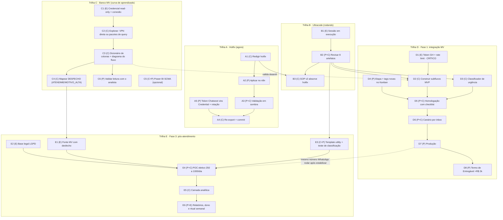

# TODO — Programa Ana: guia de execução até o final

> Fonte de verdade operacional do projeto. O `roadmap/index.html` conta a história para gestão; este arquivo guia o trabalho dia a dia. Cada tarefa tem **ID estável**, **dono**, **dependências**, e uma ficha de detalhe com contexto, passos e critério de pronto. A seção "Fronteira de agora" diz o que está desbloqueado neste momento e é reescrita a cada avanço.
>
> **Para atualizar este arquivo e receber orientação: digite `/check` numa sessão Claude Code aberta neste diretório.** A skill local lê o TODO, o git, o diretório e o n8n, reescreve a fronteira e devolve os próximos passos com sugestões.

**Status:** `[ ]` a fazer · `[~]` em curso · `[x]` feito · `[!]` bloqueada
**Donos:** **(P)** Pedro · **(C)** Claude (sessões) · **(E)** Externo (hospital, Global Health, jurídico)

---

## Fronteira de agora (06/jul/2026 · destravou: token GH homolog + banco Oracle confirmado)

Verificado em 06/jul: produção do n8n segue SEM o hotfix (todos os workflows com `updatedAt` de 28/mai). Novidades do dia: (1) token de homologação da GH recebido e salvo em `.env` na raiz (fora do git; ver .gitignore); (2) banco do DBeaver confirmado como Oracle, C1 fechada; (3) E2 (LGPD) adiada por decisão do Pedro: direção não prioriza LGPD nesta fase de testes (retomar antes de E4). Sobre A2: o MCP do n8n conectado só expõe leitura/execução (não tem tool de update); o caminho automático continua sendo Pedro gerar uma API key em Settings > n8n API, ou colar manual.

| # | Tarefa | Dono | Por que agora |
|---|---|---|---|
| A1 | Redigir o hotfix do prompt (extrair delta Fase 0 do v2) | C | Produção segue sem regra de urgência; é a tarefa mais barata com maior redução de risco |
| A2 | Aplicar no n8n (API key em Settings > n8n API, ou colar manual) | P+C | Logo após A1 aprovado |
| C2 | Rodar Pacotes 1 e 2 de `ana/api-mv/queries-exploracao.md` no DBeaver (Oracle) | P+C | C1 fechou em 06/jul; os pacotes confirmam schema e destravam C3/C4 |
| D1 | Pedir token de PRODUÇÃO + rate limit + contato técnico da GH | P→E | Homolog já chegou (06/jul); a metade que falta continua no caminho crítico |
| B2 | Revisar os 8 artefatos do ultracode e ratificar decisões com o Felipe | P+C | Destrava D2, D3 e E3; síntese em `roadmap/relatorio-pesquisa.md` |
| D2 | Começar os subfluxos MVP contra homologação (após B2) | C | Token homolog em mãos permite testar T6/T1/T2 de verdade |

---

## Árvore de dependências

Leituras da árvore:
- **Caminho crítico até a receita (+R$ 2k):** D1 → D2 → D5 → D6 → D7 → D8. Tudo começa no token GH; por isso D1 se pede HOJE.
- **Trilhas A, B e C são independentes entre si**: hotfix, pesquisa e banco andam em paralelo total.
- **C alimenta E**: sem mapear o desfecho no banco (C4), a Fase 3 não tem filtro seguro (E1).
- **B2 é o pivô**: a revisão dos artefatos do ultracode destrava a construção (D2, D3) e o template (E3).

---

## Trilha A — Hotfix do prompt (agora)

| ID | St | Tarefa | Dono | Depende de |
|---|---|---|---|---|
| A1 | `[ ]` | Redigir `Ana_System_Prompt.md` v1.1 (bloco crítico completo) | C | nada |
| A2 | `[ ]` | Aplicar no nó `Agente IA Hospital` do n8n | P | A1 |
| A3 | `[ ]` | Validação em sombra por período curto | P+C | A2 |
| A4 | `[ ]` | Re-exportar workflows para `ana/workflows/` e commitar | C | A3, A5 |
| A5 | `[ ]` | Migrar token Chatwoot para Credential + rotacionar | P | nada |

### A1 · Redigir o hotfix (v1.1 do prompt)

**Contexto:** o prompt em produção tem lacunas apontadas pelo briefing do diretor e confirmadas na análise de 03/jul. A mais grave: paciente com sinal de emergência ("dor no peito") hoje cai na regra "não orientar sobre sintoma" e fica sem direcionamento ao PS.

**Escopo exato da edição (nada além disso):**
1. **Nova Regra Global 1 + seção de urgência no topo do SOP:** detectar sinais de emergência (dor no peito, falta de ar, sangramento intenso, desmaio, convulsão, sinais de AVC, dor abdominal severa, febre muito alta em bebê, trauma, autoagressão, risco iminente à vida) e responder imediatamente: orientar PS presencial 24h (Adulto, Pediátrico, Ortopédico) ou SAMU 192, com endereço; sem diagnosticar, sem agendar, sem fluxo comercial, sem coletar lead. Na dúvida, orientar o PS (falso-positivo é aceitável, falso-negativo não).
2. **Regra Global 6 reescrita:** Ana se apresenta como assistente virtual quando perguntada, nunca nega ser IA, nunca expõe detalhes técnicos internos (fluxos, ferramentas, funil, lógica). Ajustar a resposta padrão "você é um robô?" para ficar coerente.
3. **Regra de exclusão ouvidoria↔comercial:** ao aplicar a tag `ouvidoria`, o modo comercial morre para a thread (sem ancoragem de valor, sem oferta particular, sem aquecimento) até o fluxo de ouvidoria encerrar. Agendamento pedido no meio da queixa vira novo fluxo depois do acolhimento completo.
4. **Guardrails jurídicos da ouvidoria (Seção 7):** trocar a mensagem de acolhimento ("Lamento muito que sua experiência não tenha sido a que você merecia" pressupõe culpa) por acolhimento do sentimento sem validar a acusação; nunca admitir falha do hospital; nunca prometer providência específica; nunca dar parecer sobre conduta; nunca desencorajar registro formal.
5. **Ajustes menores:** acentuação nas Seções 3.2 e 7.3; conectar a tag `fora-horario` na Seção 10; acionar a etapa `EM ATENDIMENTO — ANA` na Seção 1.1 (após identificar o motivo); na Seção 8.4, aplicar tag `prontuario` e registrar a dúvida de status em vez de sumir do CRM.

**Passos:** editar `ana/prompt/Ana_System_Prompt.md` → gerar diff comentado para revisão do Pedro → ajustar pelo feedback → commit.

**Pronto quando:** diff aprovado pelo Pedro; blocos de mensagem respeitam o limite de 320 caracteres; numeração das Regras Globais íntegra de 1 a 11; nenhuma tag/etapa referenciada fora da tabela de ferramentas.

**Referências:** `ana/briefings/Briefing...md` (I.1 a I.7), decisões do grilling de 03/jul e, principalmente, `ana/prompt/Ana_System_Prompt_v2.md`: o preâmbulo do v2 mapeia exatamente os blocos do hotfix (Fase 0) a portar para o prompt de produção, já revisados pelas melhores práticas da pesquisa (inclui a saudação "assistente virtual" exigida pela CFM 2.454/2026 e o texto fixo de urgência com CVV 188). O trabalho de A1 vira: extrair o delta Fase 0 do v2, não redigir do zero.

### A2 · Aplicar no n8n

**Contexto:** o systemMessage do nó é uma expressão n8n: começa com `=` e injeta data/hora e PERÍODO_FDS via `{{ }}`. Colar errado quebra a injeção.

**Passos:** abrir o workflow `Ana` (id `mwboSUbv8n4TBwPf`) → nó `Agente IA Hospital` → substituir o systemMessage preservando o `=` inicial e as expressões `{{ }}` → salvar → enviar mensagem de teste num contato de teste. Alternativa sem toque manual (preferida pelo Pedro em 04/jul): Pedro gera API key no n8n (Settings > n8n API em `n8nia.mala-ia.cloud`) e Claude aplica via REST (`PUT /api/v1/workflows/{id}`). Verificado em 04/jul: o MCP do n8n conectado à sessão é somente leitura/execução e o token dele retorna 401 na API REST; a API key é o único caminho automático.

**Pronto quando:** mensagem de teste responde com o comportamento novo (ex.: "estou com dor no peito" retorna orientação de PS/SAMU imediatamente).

### A3 · Validação em sombra

**Contexto:** o briefing recomenda rodar com revisão humana antes de considerar o hotfix entregue, para calibrar tom com casos reais (III.3.2).

**Passos:** definir janela (2 a 3 dias úteis); durante a janela, revisar diariamente as conversas reais no Chatwoot com foco em: disparos de urgência (todos corretos?), ouvidoria (acolhimento sem admissão de culpa?), comercial (tom consultivo?); rodar bateria sintética de ~15 mensagens de teste cobrindo: urgência clara, urgência ambígua ("dor de cabeça forte"), "você é um robô?", reclamação que vira pedido de agendamento, preço de cirurgia, contato fora de horário.

**Pronto quando:** bateria sintética 100% correta e nenhum incidente na janela de conversas reais.

### A4 · Re-export e commit

**Passos:** exportar `Ana.json` (e qualquer subfluxo alterado) → sobrescrever em `ana/workflows/` → conferir que `ana/prompt/Ana_System_Prompt.md` e o nó estão idênticos → commit.

**Pronto quando:** `git diff` limpo entre prompt do repo e prompt do nó; exports sem nenhum token em texto puro (depende de A5).

### A5 · Token Chatwoot vira Credential + rotação

**Contexto:** o `api_access_token` do Chatwoot está hardcoded nos nós HTTP de vários workflows e no histórico deste git (local). Enquanto isso não for limpo, o repo não pode ir para nenhum remote.

**Passos:** no n8n, criar Credential (Header Auth `api_access_token`) → apontar todos os nós HTTP do Chatwoot para a credencial (workflows: Ana, Desliga Ana, Atualizar_lead, Aplicar_tag, Escalar_humano, Agendamento_convenio, Registrar_reclamacao) → gerar novo token no Chatwoot e revogar o antigo → testar os fluxos.

**Pronto quando:** grep por token nos exports novos retorna vazio e o token antigo está revogado.

---

## Trilha B — Pesquisa ultracode

| ID | St | Tarefa | Dono | Depende de |
|---|---|---|---|---|
| B1 | `[x]` | Sessão ultracode concluída (03/jul): 8 artefatos commitados | E | nada |
| B2 | `[ ]` | Revisar os 8 artefatos, decidir o que entra, commitar | P+C | B1 |
| B3 | `[ ]` | Consolidar SOP v2 (hotfix + agendamento + pesquisa) | C | A1, B2 |

### B1 · Sessão concluída (03/jul/2026)

**Todos os 8 artefatos entregues e commitados:** `ana/prompt/Ana_System_Prompt_v2.md`, `pos-atendimento/viabilidade-webchat.md`, `docs/adr/0003-base-de-conhecimento.md`, `pos-atendimento/templates-meta.md`, `docs/06-spec-classificador-urgencia.md`, `pos-atendimento/arquitetura-analitica.md`, `ana/api-mv/perguntas-global-health.md`, `roadmap/relatorio-pesquisa.md` (+ roadmap visual e queries da Trilha C atualizados).

**Achados que mudam o plano** (detalhe no relatório): fim da janela grátis da Meta em 01/out/2026; CFM 2.454/2026 exige comunicar o uso de IA (~ago/2026); CPF em texto livre conflita com a policy da Meta; D1 grave no desenho do T2 (convênio particular tem id próprio); desfecho no MV vive em `MOT_ALT` (`TP_MOT_ALTA='O'` = óbito); webchat por link reprovado; fator utility vs marketing é ~9x.

### B2 · Revisão dos artefatos

**Ordem de leitura sugerida:** `relatorio-pesquisa.md` primeiro (síntese), depois `viabilidade-webchat.md` (resposta para o Felipe), depois os specs na ordem em que serão usados (classificador → templates → analítica → ADR base de conhecimento).

**Critérios de aceite por artefato:** afirmações de custo/política com fonte e data; recomendação clara (não um "depende" genérico); acionável sem retrabalho (specs com entradas/saídas definidas).

**Pronto quando:** cada artefato marcado como aceito, aceito-com-ajustes ou rejeitado; decisões registradas (ADR se irreversível); commit; fronteira atualizada (D2, D3 e E3 possivelmente destravadas).

### B3 · SOP v2 consolidado

**Contexto:** o v2 do ultracode nasce do prompt antigo; o hotfix (A1) entra em produção antes. Consolidar = aplicar no v2 qualquer ajuste que a validação em sombra (A3) tiver ensinado, e garantir que o v2 contém o hotfix inteiro.

**Pronto quando:** `Ana_System_Prompt_v2.md` é um superconjunto verificado do v1.1 + seções de agendamento; vira o texto que sobe na Fase D5.

---

## Trilha C — Banco MV (curva de aprendizado)

| ID | St | Tarefa | Dono | Depende de |
|---|---|---|---|---|
| C1 | `[x]` | Credencial Oracle read-only + dados de conexão + schema | P→E | nada |
| C2 | `[ ]` | Explorar estrutura (VPN direta ou pacotes de query) | C | C1 |
| C3 | `[ ]` | Dicionário de colunas + diagrama do fluxo de agendamento | C | C2 |
| C4 | `[ ]` | Mapear onde vive o DESFECHO e como filtrar | C | C3 |
| C5 | `[ ]` | (Opcional) Varredura do Power BI módulo SCMA | C+P | navegador aberto |
| C6 | `[ ]` | Validar leitura do modelo com o analista de TI | P | C3 |

### C1 · Credencial e conexão

**Fechada em 06/jul:** Pedro confirmou que a conexão do DBeaver é Oracle (login/senha funcionando). As duas pendências restantes (confirmar que ATENDIME e as tabelas de agendamento vivem nesse banco; descobrir o owner/schema canônico) são exatamente o que a query 1.1 do Pacote 1 responde: viraram o primeiro passo de C2.

**Cuidado:** credencial NUNCA entra no repo. Guardar em variável de ambiente local ou keychain; a sessão Claude usa em memória.

### C2 · Exploração

**Caminho preferido:** VPN ligada no Mac → `pip install oracledb` (modo thin, sem client Oracle) → testar conexão → rodar os Pacotes 1 e 2 de `ana/api-mv/queries-exploracao.md` direto da sessão, iterando conforme os resultados.
**Fallback:** Pedro (ou o analista) roda os pacotes no SQL Developer/DBeaver e cola os resultados na sessão.

**Pronto quando:** resultados dos dois pacotes salvos em `ana/api-mv/resultados/` (CSV ou md) e commitados.

### C3 · Dicionário de colunas + diagrama

**Passos:** a partir dos resultados de C2, gerar `ana/api-mv/dicionario-colunas.md` (colunas, tipos, comentários, FKs das 8 tabelas + ATENDIME) e um diagrama mermaid do fluxo: escala → item de agendamento → agenda central → horário do paciente.

**Pronto quando:** o diagrama explica, com colunas reais, como um agendamento feito pela API aparece no banco (cruzando com `ATENDIME_GLOBAL_HEALTH`).

### C4 · Mapear o desfecho

**Contexto:** é a pré-condição da Fase 3 inteira (briefing II.2/II.3). Sem saber distinguir "alta melhorado" de "óbito" no banco, não há disparo seguro.

**Passos:** estrutura de `ATENDIME` (tipo de atendimento, motivo de alta, datas) + `MOT_ALT` (nome no MV clássico; `MOTIVO_ALTA` como fallback; classificar cada motivo como benigno/adverso/óbito) + `PACIENTE_OBITO`; a pesquisa ultracode já deixou a query candidata pronta com 3 sinais redundantes de óbito em `ana/api-mv/perguntas-global-health.md` (seção de hipóteses): validar contra o banco real.

**Pronto quando:** a query candidata roda e o analista confirma a semântica dos motivos de alta (C6).

### C5 · Power BI (módulo SCMA)

**Passos:** Pedro abre o Chrome com a extensão ativa → Claude navega no link público do relatório → módulo SCMA → filtro de esquema em MVBIKE e MVINTEGRA → extrair páginas, KPIs e nomes de medidas para `ana/api-mv/powerbi-scma.md`.

**Valor:** ver quais indicadores a gestão já acompanha (bom para desenhar o relatório do pós-atendimento na mesma língua).

---

## Trilha D — Fase 1: integração MV

| ID | St | Tarefa | Dono | Depende de |
|---|---|---|---|---|
| D1 | `[~]` | Token GH: homolog RECEBIDO (06/jul); falta prod + rate limit | P→E | nada |
| D2 | `[ ]` | Construir subfluxos MVP (T6→T1→T2→T5→T7) | C | D1, B2 |
| D3 | `[ ]` | Classificador de urgência antes do agente | C | B2 |
| D4 | `[ ]` | Etapa `FALHA AGENDAMENTO — FILA` + tags novas no Kanban | P | nada |
| D5 | `[ ]` | Homologação com checklist completo | P+C | D2, D3, D4 |
| D6 | `[ ]` | Canário por inbox | P+C | D5 |
| D7 | `[ ]` | Produção | P | D6 |
| D8 | `[ ]` | Termo de Entregável da Ana (+R$ 2.000/mês) | P | D7 |

### D1 · Token Global Health

**Status 06/jul:** token de homologação recebido e salvo em `.env` na raiz do repo (`GH_TOKEN_HOMOLOG`, fora do git via .gitignore). **Falta pedir** (via contato do hospital com a GH): token de produção (`whatsapp.agenda.globalhealth.mv/rest/whatsapp`); limite de chamadas simultâneas e rate limit; contato técnico para dúvidas da integração.

**Pronto quando:** os dois tokens guardados como Credential no n8n (`GH Token (Homolog)` / `GH Token (Prod)`, header `Token`) e o rate limit documentado em `ana/api-mv/perguntas-global-health.md`. (O `.env` local é ponte até as Credentials existirem no n8n.)

### D2 · Subfluxos MVP

**Escopo:** T6 `Listar_agendamentos` → T1 `Identificar_paciente` → T2 `Buscar_disponibilidade` → T5 `Efetivar_agendamento` → T7 `Remarcar_ou_cancelar`, conforme specs nó a nó de `docs/02-arquitetura-agendamento.md` §4 (T3/T4 ficam para a Fase 2). Inclui: estado em `custom_attributes.agendamento_estado` (ler/gravar/limpar), TTL de 24h, mapa número→ID, prefixos-sinal, confirmação em 3 camadas nos subfluxos de escrita, `onError: continueRegularOutput` em todo nó HTTP, e limpeza do estado no `/reset`.

**Passos:** construir cada subfluxo → testar isolado com `Execute Workflow` + pinData contra homologação → plugar os 5 nós `toolWorkflow` no agente → subir SOP v2 → testar ponta a ponta.

**Pronto quando:** os 5 subfluxos passam nos testes isolados E o fluxo ponta a ponta agenda, lista, remarca e cancela em homologação.

**Pré-verificação:** confirmar que a credencial Chatwoot em uso escreve `custom_attributes` (doc 05, pré-requisito 0).

### D3 · Classificador de urgência

**Contexto:** segunda camada da defesa (a primeira é a Regra 1 do hotfix). Spec vem do ultracode (`docs/06-spec-classificador-urgencia.md`).

**Forma esperada:** nó de classificação binária antes do `Agente IA Hospital` (modelo pequeno/rápido); se urgência, resposta padrão de PS/SAMU sai na hora, sem passar pelo agente; registrar o caso (tag) para auditoria.

**Pronto quando:** conjunto de teste (frases de urgência reais e ambíguas, incluindo gírias e erros de digitação) roda com zero falso-negativo, e a latência adicionada por mensagem é aceitável (medir).

### D4 · Kanban e tags

**Passos:** criar a etapa `FALHA AGENDAMENTO — FILA` no board; criar tags `agendado-bot`, `remarcacao`, `cancelamento`; atualizar a descrição da tool `Atualizar_lead` (ela injeta a lista de etapas do board por expressão: conferir que a nova etapa aparece).

### D5 · Homologação

**Checklist (docs/05 §4):** caso feliz das 6 jornadas; os 7 fallbacks (`BLOQUEADO:`, `BLOQUEIO_EXAME:`, `SEM_HORARIOS`, `NAO_AGENDADO:`, `ERRO_API`, `ERRO_ANEXO`, `NUMERO_INVALIDO`); guardrails (efetivar sem confirmado=true barrado pelo nó-gate; CPF ≠ 11 dígitos não avança; estado limpo após efetivar; `/reset` limpa estado; LLM não emite ID que não veio de tool).

**Pronto quando:** checklist 100% verde, com evidências anotadas.

### D6 · Canário

**Passos:** habilitar para um subconjunto (uma inbox ou horário restrito); acompanhar diariamente: taxa `agendado-bot` vs `FALHA AGENDAMENTO — FILA`, reclamações, conversas travadas.

**Pronto quando:** período definido (sugestão: 1 semana) sem incidente grave e taxa de falha aceitável.

### D7 · Produção

**Passos:** trocar `GH_BASE_URL` para produção + credencial prod → smoke test → comunicar equipe humana (o fallback continua sendo deles) → monitorar primeira semana.

**Pronto quando:** primeiro agendamento real confirmado dentro do MV pelo hospital.

### D8 · Termo de Entregável

**Passos:** emitir o Termo (1 a 2 páginas: o que foi entregue, valor que destrava) usando a esteira de `contrato/` → assinatura → mensalidade passa de R$ 6.000 para R$ 8.000.

**Antes de assinar:** fechar F3 (dimensionar manutenção recorrente).

---

## Trilha E — Fase 3: pós-atendimento

| ID | St | Tarefa | Dono | Depende de |
|---|---|---|---|---|
| E1 | `[ ]` | Fonte MV: atendidos com serviço, data, setor/profissional e DESFECHO | E | C4 |
| E2 | `[ ]` | Base legal LGPD do contato proativo (ADIADA 06/jul: retomar antes de E4) | P→E | nada |
| E3 | `[ ]` | Template utility de abertura + teste de classificação | C+P | B2 |
| E4 | `[ ]` | POC eletivo (250 a 1.000/dia, opt-out, métricas) | P+C | E1, E2, E3 |
| E5 | `[ ]` | Camada analítica (banco, classificação auditada, agregação) | C | E4 |
| E6 | `[ ]` | Categorias com coordenadores + dono + ritual semanal | P+E | E5 |

### E1 · Fonte de dados com desfecho

**Contexto:** decisão fechada do briefing (II.3): a fonte vem do MV, nunca de lista solta de telefones. A query candidata nasce em C4; aqui ela vira rotina (export diário/semanal ou leitura direta) com o TI do hospital.

**Pronto quando:** extração de um dia real validada: só eletivo, só desfecho benigno, com os campos para personalizar o template.

### E2 · Base legal LGPD

**Adiada em 06/jul por decisão do Pedro:** a direção não prioriza LGPD nesta fase de desenvolvimento/testes. A tarefa NÃO está cancelada: ela é pré-condição dura do disparo em massa (E4) e o lead time do jurídico é longo; reabrir assim que a Fase 3 entrar no horizonte (o mais tardar junto com E3).

**Pergunta ao jurídico:** o termo de atendimento assinado autoriza contato proativo por WhatsApp para pesquisa de satisfação? Se não: qual o caminho (ajuste do termo para novos pacientes? legítimo interesse documentado? opt-in na alta?).

**Insumo da pesquisa (03/jul):** o guia da ANPD veda legítimo interesse para dado sensível, e o disparo revela vínculo com serviço de saúde: o caminho seguro é consentimento específico no termo, nomeando hospital + canal WhatsApp + finalidade. Isso resolve simultaneamente o opt-in exigido pela Meta (papel assinado é canal aceito). Levar junto: a decisão documentada sobre coleta de CPF em texto livre (conflita com a policy da Meta) e a pauta CFM 2.454/2026 (avaliação de risco + Comissão de IA até ~ago/2026). Perguntas prontas na seção f.4 do draft de compliance, resumidas no `roadmap/relatorio-pesquisa.md`.

**Pronto quando:** base legal documentada por escrito (guardar em `pos-atendimento/`).

### E3 · Template de abertura

**Contexto:** a diferença entre utility (US$ 0,0068 a 0,008) e marketing (US$ 0,0625) é ~9x no custo de 25 a 35 mil disparos/mês. A Meta reclassifica unilateralmente e em silêncio desde abr/2025; o texto precisa nascer transacional puro. Os 5 drafts prontos estão em `pos-atendimento/templates-meta.md`, com o processo de validação e o webhook `template_category_update` a assinar. Atenção ao bloqueante novo: opt-in válido exige o termo de balcão reescrito (nomear hospital + WhatsApp + finalidade), ver E2.

**Passos:** escolher draft → registrar template na Meta (via BSP) → disparar amostra pequena (dezenas) → verificar na fatura/painel como foi classificado e cobrado → medir taxa de resposta da amostra.

**Pronto quando:** template aprovado pela Meta E cobrado como utility na prática E taxa de resposta da amostra documentada.

### E4 · POC eletivo

**Escopo:** exame/cirurgia eletiva (~500/mês) + ambulatório (10 a 15 mil/mês), começando em 250 a 1.000/dia; opt-out em toda mensagem; ramificação por sentimento (nota alta → convite Google legítimo; neutra/negativa → captura de detalhe + fechamento de loop, casos graves roteados para ouvidoria).

**Métricas do POC:** taxa de resposta, taxa de conclusão da pesquisa, distribuição de NPS, custo real por resposta, opt-outs, reclamações sobre o próprio disparo.

**Pronto quando:** relatório do POC com as métricas e decisão de escala (ou ajuste).

### E5 · Camada analítica

**Conforme spec do ultracode** (`pos-atendimento/arquitetura-analitica.md`): armazenar cada resposta classificada (sentimento, setor, profissional, tema, data, serviço); classificação por IA com auditoria amostral (cuidado redobrado em atribuição nominal a profissional); agregação semanal/mensal com evolução no tempo.

### E6 · Categorias e ritual

**Contexto:** relatório sem dono vira PDF morto (briefing II.6). Categorias co-desenhadas com quem age; metodologia congelada para permitir análise evolutiva; ritual semanal (Gisele + coordenadores) com regra "categoria acima do limiar vira ação com responsável".

---

## Trilha F — Contínuo

| ID | St | Tarefa | Dono | Quando |
|---|---|---|---|---|
| F1 | `[ ]` | Comunicar ao Felipe: Regra 6 implementada + veredito do web-chat | P | após A2 e B2 |
| F2 | `[~]` | Manter exports, TODO, roadmap e memória sincronizados | C | sempre (via /check) |
| F3 | `[ ]` | Dimensionar manutenção recorrente no contrato (III.2.8) | P | antes de D8 |

### F1 · Comunicação com o Felipe

Dois assuntos prontos para pauta: (1) Regra 6: recomendação dele acatada e implementada, com o racional (política Meta 2026 + contradição interna do prompt antigo); (2) ideia do web-chat: levar o veredito da pesquisa com números, incluindo a correção da premissa (reativo já é grátis) e o atalho do widget Chatwoot.

### F3 · Manutenção recorrente

**Contexto:** briefing III.2.8: a economia de folha não é total; quando a GH muda a API, entra convênio novo, ou a Meta muda regra, há carga de engenharia. Estimar horas/mês típicas e refletir no contrato (a mensalidade da Ana já cobre? precisa de cláusula?). Fechar antes de assinar o Termo (D8) para não pactuar manutenção de graça.

---

## Concluído (log)

- `[x]` 03/jul: Repo git + reorganização por domínio + README (Fase 0)
- `[x]` 03/jul: Glossário do domínio no CONTEXT.md
- `[x]` 03/jul: Meta-prompt do ultracode (`roadmap/prompt-sessao-ultracode.md`) + disparo da sessão
- `[x]` 03/jul: Roadmap visual (`roadmap/index.html`)
- `[x]` 03/jul: Dicionário de tabelas MV destilado da planilha do TI (`ana/api-mv/dicionario-tabelas-mv.md`)
- `[x]` 03/jul: Decisões do grilling registradas (hotfix primeiro, urgência 2 camadas, Regra 6, ultracode = pesquisa+SOP+specs)
- `[x]` 03/jul: Skill local `/check` criada (`.claude/skills/check/`)
- `[x]` 03/jul: Sessão ultracode concluída: 8 artefatos commitados (69 agentes, verificação adversarial); síntese e 8 decisões recomendadas em `roadmap/relatorio-pesquisa.md`; roadmap visual e queries da Trilha C (MOT_ALT) atualizados
- `[x]` 04/jul: `roadmap/pesquisa-ultracode.html` removido a pedido do Pedro (conteúdo preservado no histórico git e em `relatorio-pesquisa.md`; nenhum arquivo o referenciava)
- `[x]` 04/jul: Verificado que a produção do n8n não contém o hotfix (updatedAt 28/mai em todos os workflows; export do repo sem bloco de urgência) e que não há drift produção vs `ana/workflows/`
- `[x]` 06/jul: C1 fechada: conexão DBeaver confirmada como Oracle; owner/schema vira a query 1.1 do Pacote 1 (C2)
- `[x]` 06/jul: Token de homologação da Global Health recebido; salvo em `.env` local (fora do git), `.gitignore` atualizado (`.env`, `tokens/`)
